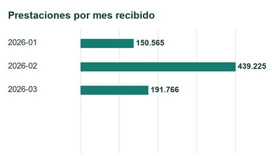
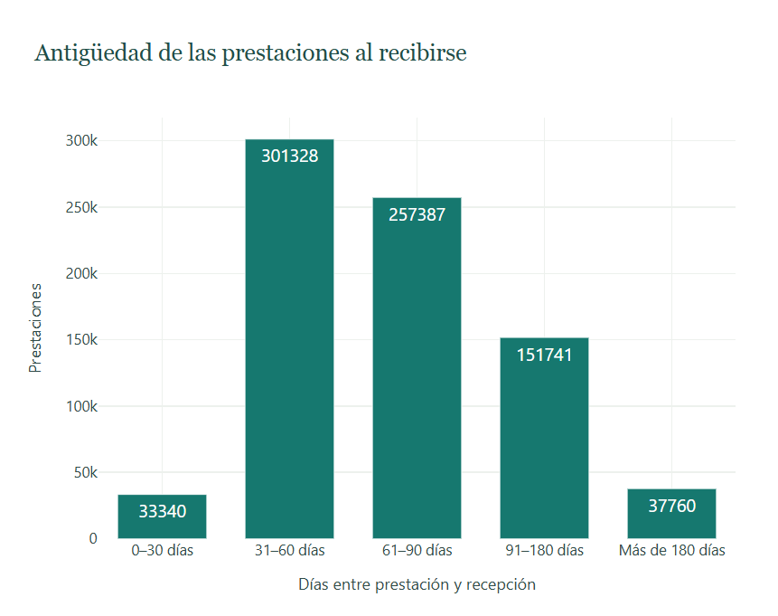
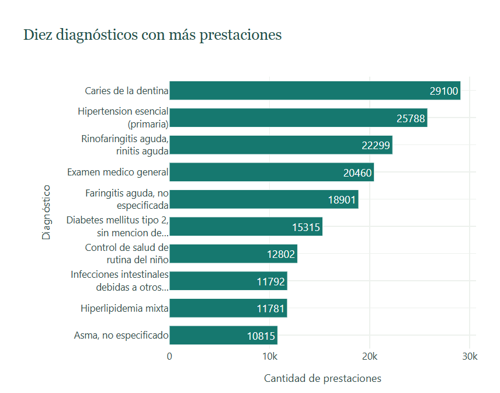
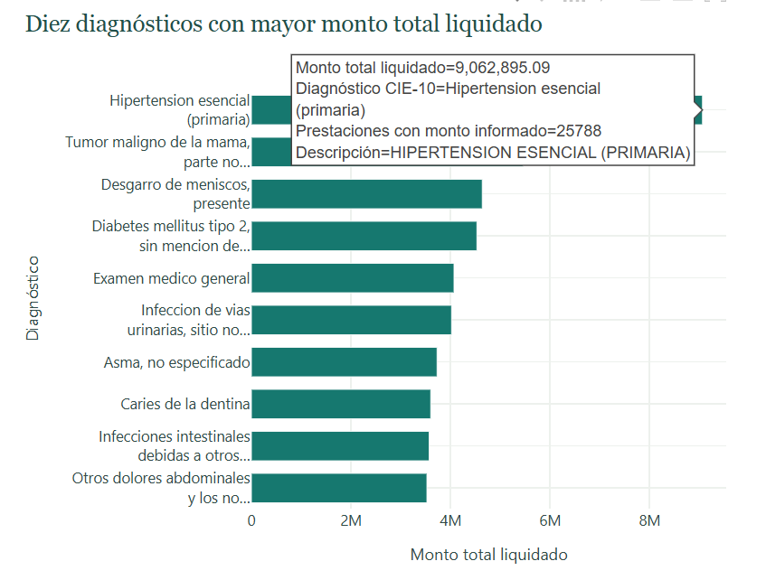
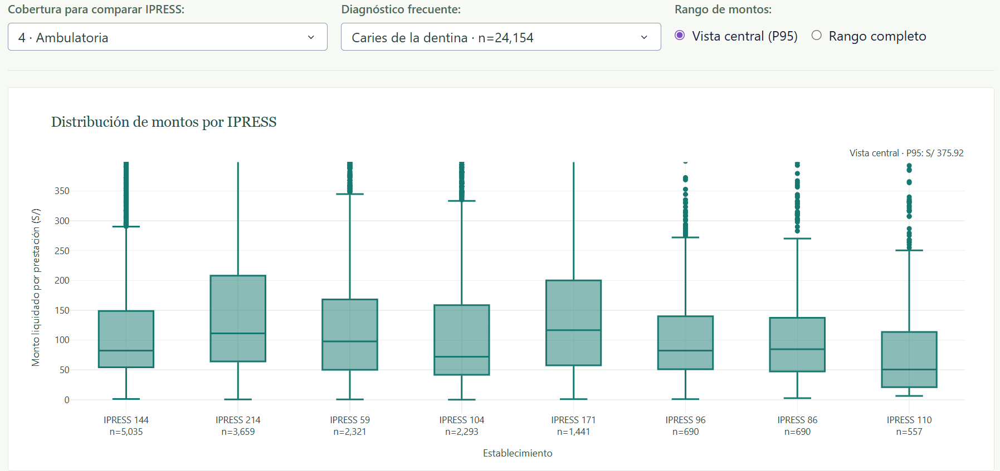
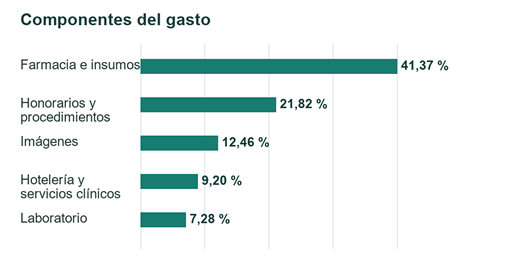
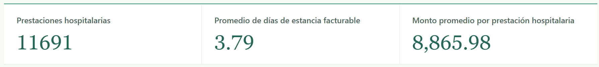

# Proyecto Final - Análisis de la demanda y el gasto de las prestaciones de salud del sector privado peruano

**Business Intelligence**

**Integrantes:**

- Luciana Carpio

- Sofía Briceño

- Adriano Raffo

## Base de datos

**[Descargar la base de datos completa — BD_pagos.xlsx](https://drive.google.com/file/d/1Ri3luNhryb4HQ4lAhFL6C7V5P442mG6m/view?usp=drive_link)**

## 1. Marco teórico

### 1.1. Business Intelligence

El Business Intelligence (BI), o inteligencia empresarial, comprende un conjunto de procesos y herramientas tecnológicas que permiten recopilar, integrar y analizar datos para convertirlos en información útil, la cual se emplea en la toma de decisiones. Su propósito es facilitar que las organizaciones entiendan mejor su desempeño, identifiquen patrones y detecten problemas u oportunidades a partir de datos confiables.

La implementación de BI permite elaborar reportes, indicadores y visualizaciones que presentan información y facilitan su interpretación. Así, los responsables de una empresa pueden tomar decisiones fundamentadas en evidencia y no únicamente en percepciones o experiencias previas. BI permite realizar un seguimiento del comportamiento histórico de las operaciones y comparar sus resultados entre diferentes periodos, áreas o categorías.

En el sector salud, Business Intelligence puede utilizarse para analizar grandes volúmenes de información relacionada con pacientes, establecimientos, aseguradoras, diagnósticos, coberturas, prestaciones y gastos. A partir de este análisis, las organizaciones pueden identificar los tipos de atención con mayor demanda, los diagnósticos y establecimientos que concentran mayores gastos, así como diferencias según ubicación, cobertura o características de los pacientes. Por lo tanto, la aplicación de BI contribuye a convertir los registros de prestaciones de salud en información relevante para mejorar la planificación y apoyar la toma de decisiones en el sector.

### 1.2. Data warehouse

Un data warehouse o almacén de datos es un sistema diseñado para recopilar, integrar y almacenar información proveniente de distintas fuentes con el propósito de facilitar su análisis. A diferencia de una base de datos operacional, que registra las actividades diarias de una organización, un data warehouse conserva información histórica y se orienta a la elaboración de reportes y al apoyo en la toma de decisiones.

Algunas de sus características son las siguientes: está orientado a temas, porque organiza los datos según áreas relevantes; es integrado, ya que reúne información con formatos consistentes; es variante en el tiempo, porque permite analizar datos históricos; y es no volátil, debido a que la información almacenada se mantiene estable para su consulta.

### 1.3. Data Mart

Un Data Mart es una base de datos analítica orientada a un área, proceso o tema específico de una organización. A diferencia de un data warehouse, que puede integrar información de distintas áreas empresariales, un Data Mart contiene un conjunto más delimitado de datos y busca responder necesidades concretas de análisis. Esta especialización facilita el acceso a la información relevante y permite realizar consultas enfocadas en un determinado proceso de negocio.

Un Data Mart puede obtener sus datos de un data warehouse, pero también puede construirse directamente a partir de fuentes internas o externas. Su información suele organizarse mediante un modelo dimensional compuesto por una tabla de hechos y distintas tablas de dimensiones, lo que permite analizar las medidas desde diferentes perspectivas.

### 1.4. Modelamiento multidimensional

El modelamiento multidimensional es una técnica utilizada para organizar los datos de forma que puedan ser consultados y analizados con facilidad. Su diseño parte de un proceso de negocio y separa la información en hechos, que representan eventos o métricas de negocio, y dimensiones, que proporcionan el contexto necesario para analizarlos, como el tiempo, la ubicación o la empresa involucrada.

Para elaborar un modelo multidimensional, primero se selecciona el proceso de negocio, luego se define la granularidad, es decir, qué representa cada fila de la tabla de hechos. Después se identifican las dimensiones y las medidas asociadas al proceso. Esta organización permite filtrar, agrupar y resumir grandes cantidades de datos desde distintas perspectivas. Existen varios tipos de modelos multidimensionales como los siguientes:

- **Modelo estrella:** Está conformado por una tabla de hechos central conectada directamente con diferentes tablas de dimensiones, lo cual forma una figura similar a una estrella. La tabla central almacena los eventos y medidas del proceso analizado, mientras que las dimensiones contienen la información descriptiva empleada para filtrar y agrupar los resultados. Su diseño facilita la comprensión del modelo, reduce la complejidad de las consultas y permite analizar las medidas desde distintas perspectivas. Además, las dimensiones suelen estar desnormalizadas, es decir, sus atributos se conservan en una misma tabla para simplificar el análisis.

- **Tabla de hechos y granularidad:** La tabla de hechos es la tabla central de un modelo estrella. En ella se registran los eventos correspondientes a un proceso de negocio y las medidas que se desean analizar, como cantidades, importes, costos o duraciones. También contiene claves foráneas que permiten relacionar cada evento con sus respectivas dimensiones. 

La granularidad define exactamente qué representa cada fila de la tabla de hechos. Por ejemplo, una fila podría representar una venta completa o un producto individual dentro de una venta. Esta definición debe realizarse antes de seleccionar las dimensiones y medidas, ya que todos los datos de la tabla deben corresponder al mismo nivel de detalle. Una granularidad correctamente definida permite interpretar las medidas de manera consistente y evita combinar información perteneciente a distintos niveles de análisis.

- **Tablas de dimensiones:** Las tablas de dimensiones almacenan la información descriptiva que permite interpretar y analizar los registros de la tabla de hechos. Sus atributos responden preguntas como quién, qué, cuándo, dónde y cómo ocurrió un evento. Estas tablas se utilizan para filtrar, clasificar y agrupar las medidas. Además, pueden contener jerarquías que permiten analizar la información con distintos niveles de detalle como departamento, provincia y distrito.

Cada dimensión posee una clave que identifica de manera única sus registros y que se conecta con la tabla de hechos. En los modelos dimensionales suelen utilizarse claves sustitutas, generadas específicamente para el data warehouse, en lugar de depender únicamente de los identificadores de los sistemas de origen.

### 1.5. Proceso ETL

El proceso ETL comprende las etapas de extracción, transformación y carga de datos. En la extracción se obtiene la información desde las fuentes originales; durante la transformación, los datos se limpian, organizan, integran y adaptan a la estructura requerida; finalmente, en la carga, la información procesada se almacena en un data warehouse, Data Mart u otro repositorio de destino.

Este proceso permite convertir datos provenientes de diferentes archivos o sistemas en información consistente y preparada para el análisis. Durante la transformación pueden realizarse actividades como la corrección de formatos, el tratamiento de valores nulos, la eliminación de duplicados, la validación de registros y la creación de campos derivados. De esta manera, ETL contribuye a mejorar la calidad y uniformidad de los datos utilizados en una solución de Business Intelligence

### 1.6. Procesamiento analítico OLAP

El procesamiento analítico en línea u OLAP es una tecnología que permite analizar grandes volúmenes de información desde diferentes perspectivas. Se utiliza principalmente con datos almacenados en un data warehouse y facilita la ejecución rápida de consultas, comparaciones y cálculos complejos.

La información suele organizarse en estructuras multidimensionales conocidas como cubos OLAP. Estos contienen medidas numéricas y dimensiones que permiten observar un mismo resultado según diferentes criterios, como tiempo, ubicación o categoría.

OLAP también permite cambiar el nivel de detalle del análisis. Por ejemplo, se puede pasar de una visión anual a una mensual, filtrar una categoría específica o comparar diferentes grupos. De esta manera, los usuarios pueden explorar la información e identificar tendencias o patrones que apoyen la toma de decisiones.

### 1.7. Indicadores de prestaciones y gastos de salud

Los indicadores de prestaciones y gastos de salud permiten analizar la demanda de servicios y la distribución de los recursos económicos asociados con la atención de los pacientes. Entre los principales indicadores se encuentran la cantidad de prestaciones realizadas, el gasto total liquidado, el gasto promedio por prestación, los días promedio de estancia hospitalaria y la participación de cada componente en el gasto total, como honorarios, farmacia, laboratorio, imágenes, hotelería y prótesis. Los copagos se analizan por separado, de acuerdo con su significado.

Estos indicadores permiten comparar los resultados entre periodos, establecimientos de salud, aseguradoras, diagnósticos, tipos de cobertura y ubicaciones geográficas. Su análisis facilita la identificación de prestaciones con mayor demanda, componentes que concentran los gastos y diferencias en la utilización de los servicios, proporcionando información relevante para mejorar la planificación y apoyar la toma de decisiones en el sector salud.

### 1.8. Aplicación de BI al análisis de prestaciones de salud

Las organizaciones del sector salud generan grandes cantidades de datos relacionados con pacientes, establecimientos, aseguradoras, diagnósticos, coberturas, hospitalizaciones y gastos. Business Intelligence permite integrar y analizar esta información para convertirla en indicadores que faciliten la evaluación de la demanda de servicios y la toma de decisiones. Mediante reportes y visualizaciones, es posible comparar la cantidad de prestaciones entre periodos, identificar los diagnósticos y establecimientos que concentran mayores gastos y analizar la composición de estos según conceptos como honorarios, farmacia, laboratorio, imágenes y hotelería.

SUSALUD recopila información de las prestaciones realizadas por establecimientos privados, incluyendo características de la atención, datos demográficos anonimizados y montos asociados. De esta manera, la aplicación de BI permite identificar patrones de utilización y gasto. La información obtenida puede apoyar la planificación de recursos, el seguimiento de las prestaciones y la supervisión del sector privado de salud.

## 2. Descripción de la institución y problemática

### 2.1. Descripción de la institución

La institución seleccionada para el desarrollo del proyecto es la Superintendencia Nacional de Salud (SUSALUD), entidad del Estado peruano encargada de promover, proteger y restituir los derechos en salud de las personas. Su labor comprende la supervisión de los establecimientos y aseguradoras de salud, con la finalidad de contribuir a que los servicios sean brindados con calidad, oportunidad, disponibilidad y aceptabilidad (Superintendencia Nacional de Salud [SUSALUD], s. f.).

SUSALUD tiene competencia sobre las Instituciones Prestadoras de Servicios de Salud (IPRESS) y las Instituciones Administradoras de Fondos de Aseguramiento en Salud (IAFAS), tanto públicas como privadas y mixtas. Las IPRESS corresponden a los establecimientos y servicios médicos que realizan actividades de prevención, diagnóstico, tratamiento o rehabilitación, mientras que las IAFAS se encargan de administrar los fondos destinados al aseguramiento y a la cobertura de las prestaciones de salud.

Como parte de sus funciones de supervisión, SUSALUD recopila y publica información sobre las prestaciones realizadas en establecimientos privados. Los registros contienen datos anonimizados sobre aseguradoras, establecimientos, pacientes, diagnósticos, coberturas, hospitalizaciones, ubicación y diferentes componentes del gasto. Por ello, esta información resulta apropiada para la aplicación de herramientas de Business Intelligence que permitan analizar la demanda de prestaciones, la distribución de los gastos y las diferencias entre establecimientos, coberturas y grupos de pacientes.

El presente proyecto analizará únicamente las prestaciones reportadas por las IPRESS privadas registradas en SUSALUD que, durante el año anterior a la presentación de la información, registraron una facturación mensual promedio igual o superior a veinte Unidades Impositivas Tributarias. Esta delimitación responde al alcance de los archivos publicados por SUSALUD y significa que los resultados no representan necesariamente a todos los establecimientos privados de salud del Perú (SUSALUD, 2025b).

### 2.2. Problemática

El sector salud genera grandes volúmenes de información sobre pacientes, establecimientos, aseguradoras, diagnósticos, coberturas, hospitalizaciones y gastos. El análisis de estos datos es importante para conocer cómo se utilizan los servicios, qué prestaciones concentran la mayor demanda registrada y cómo se distribuyen los recursos económicos entre los distintos componentes de la atención. En el Perú, SUSALUD supervisa a las Instituciones Prestadoras de Servicios de Salud (IPRESS) y a las Instituciones Administradoras de Fondos de Aseguramiento en Salud (IAFAS), incluyendo sus aspectos sanitarios, administrativos y financieros (Superintendencia Nacional de Salud [SUSALUD], s. f.).

Como parte de esta labor, SUSALUD publica mensualmente registros detallados de las prestaciones realizadas por determinadas IPRESS privadas. Estos datos incluyen características de la atención, información anonimizada de los pacientes, diagnósticos, tipos de cobertura, hospitalizaciones, ubicación y diversos componentes del gasto. Sin embargo, debido al elevado volumen de registros y a la variedad de campos disponibles, resulta complejo obtener una visión consolidada que permita comparar el comportamiento de las prestaciones entre periodos, establecimientos, aseguradoras, diagnósticos y grupos de pacientes mediante consultas convencionales.

- **Impacto en la gestión de los gastos:** Cada prestación puede contener diferentes componentes económicos. El análisis separado de estos campos dificulta conocer qué conceptos concentran la mayor proporción del gasto y cómo varían según el diagnóstico, la cobertura, el establecimiento o la aseguradora. Al integrar la información se pueden identificar patrones de gasto elevado que requieran un análisis más detallado, sin asumir necesariamente que representan ineficiencias o cobros inadecuados.

- **Impacto en la planificación de las prestaciones:** La cantidad y características de las atenciones pueden variar según el periodo, el diagnóstico, u otros factores. Sin una estructura analítica que permita relacionar estas variables, resulta difícil identificar los servicios con mayor utilización, los grupos que concentran determinadas prestaciones y los periodos en los que se registra una mayor demanda. Esta información es relevante para orientar la planificación y el seguimiento de los servicios de salud.

- **Impacto en la gestión de la información:** Los datos se publican en archivos mensuales y contienen diferentes fechas, códigos anonimizados, categorías de atención y medidas monetarias. Para analizarlos de manera conjunta es necesario consolidarlos, estandarizar sus formatos y organizarlos bajo un nivel de detalle común. La ausencia de un modelo analítico específicamente preparado para el proyecto limitaría la elaboración de indicadores consistentes y la comparación de resultados entre las distintas perspectivas de análisis.

Por ello, existe la necesidad de integrar y organizar los registros de prestaciones de salud privadas mediante una solución de Business Intelligence. Esta solución permitirá realizar el seguimiento de indicadores como la cantidad de prestaciones, el gasto total y promedio, la composición del gasto y los días de estancia hospitalaria. Asimismo, facilitará la identificación de patrones según periodo, IAFAS, IPRESS, diagnóstico, cobertura, ubicación y características del paciente, proporcionando información que pueda apoyar la supervisión y la toma de decisiones basada en datos.

El análisis estará limitado a las IPRESS privadas incluidas en los archivos publicados por SUSALUD, las cuales corresponden a establecimientos que alcanzaron el nivel de facturación establecido para el reporte. Además, debido a que la fuente no contiene información completa sobre resultados clínicos, capacidad instalada o satisfacción del paciente, el proyecto no evaluará la calidad médica, la necesidad clínica de las prestaciones ni la rentabilidad de los establecimientos. Su alcance se concentrará en la utilización registrada y en la distribución de los gastos asociados (SUSALUD, 2025b).

Pregunta general de la problemática: ¿Cómo puede una solución de Business Intelligence integrar y analizar los registros de prestaciones de salud del sector privado publicados por SUSALUD para identificar patrones de utilización y gasto que apoyen la planificación, supervisión y toma de decisiones?

### 2.3. Objetivo general

Diseñar e implementar una solución de Business Intelligence para analizar las prestaciones de salud del sector privado registradas por SUSALUD, estructurada mediante un modelo en estrella e integrada con los archivos publicados en la Plataforma Nacional de Datos Abiertos, con el fin de transformar grandes volúmenes de registros en información analítica que permita identificar patrones de utilización y gasto según periodo, IAFAS, IPRESS, diagnóstico, cobertura, ubicación y características del paciente, apoyando la planificación, la supervisión y la toma de decisiones basada en datos.

### 2.4. Objetivos específicos

1. **Consolidar y preparar la fuente de datos:** Extraer, integrar, limpiar y transformar los archivos mensuales publicados por SUSALUD para construir una base de datos analítica estandarizada, validando formatos, registros duplicados, valores faltantes y consistencia de los montos.

1. **Analizar los patrones de utilización de las prestaciones:** Identificar los periodos, diagnósticos, tipos de cobertura y subtipos de prestación que concentran la mayor cantidad de atenciones registradas.

1. **Evaluar la distribución de las prestaciones:** Comparar la cantidad de atenciones y los gastos asociados según IAFAS, IPRESS, ubicación geográfica y características demográficas de los pacientes, como sexo y grupo etario.

1. **Analizar la composición de los gastos:** Determinar la participación de los honorarios, procedimientos, farmacia, laboratorio, imágenes, hotelería, prótesis y otros conceptos en la suma de componentes de gasto registrados y analizar los copagos por separado, identificando los componentes y categorías que concentran los mayores montos.

1. **Diseñar el data mart multidimensional y los tableros de control:** Construir un modelo dimensional en estrella con al menos ocho dimensiones y desarrollar tableros interactivos que faciliten el seguimiento de la utilización, los gastos y las estancias hospitalarias, apoyando la planificación, supervisión y toma de decisiones.

### 2.5. Preguntas de negocio

**Análisis temporal de las prestaciones**

- ¿Cómo varían la cantidad de prestaciones registradas y sus montos liquidados según el mes de recepción de la información en TEDEF?

- ¿En qué meses de recepción se observa el mayor monto promedio liquidado por prestación?

**Análisis por diagnósticos y coberturas**

- ¿Qué diagnósticos y tipos de cobertura concentran la mayor cantidad de prestaciones?

- ¿Qué diagnósticos presentan los mayores montos totales y promedios liquidados por prestación?

**Análisis por establecimientos, aseguradoras y ubicación**

- ¿Qué IPRESS e IAFAS concentran la mayor cantidad de prestaciones y los mayores montos liquidados?

- ¿Cómo varían los montos promedio por prestación entre IPRESS para un mismo diagnóstico y tipo de cobertura?

- ¿Cómo se distribuyen las prestaciones y los gastos registrados según la ubicación del establecimiento y la residencia del afiliado?

**Análisis de la composición del gasto y los copagos**

- ¿Qué proporción de la suma de los componentes de gasto registrados corresponde a farmacia, honorarios y procedimientos, laboratorio, imágenes, hotelería y otros conceptos?

- ¿Cómo varían los copagos promedio por prestación según la IAFAS y el tipo de cobertura?

**Análisis por características de los pacientes**

- ¿Qué grupos etarios y sexos concentran la mayor cantidad de prestaciones y los mayores montos liquidados?

- ¿Cuáles son los diagnósticos más frecuentes entre las prestaciones registradas para cada grupo etario?

**Análisis de hospitalización**

Entre las prestaciones hospitalarias, ¿qué diagnósticos y tipos de hospitalización presentan el mayor promedio de días de estancia facturable?

- ¿Cómo varía el monto promedio liquidado por prestación hospitalaria según los días de estancia facturable y el diagnóstico?

## 3. Modelamiento de datos dimensional

### 3.1. Fuente de datos

La fuente principal del proyecto es el conjunto de datos Registro de datos de atenciones de la cobertura prestacional de salud del sector privado, publicado por la Superintendencia Nacional de Salud (SUSALUD) en la Plataforma Nacional de Datos Abiertos. La base contiene información de prestaciones realizadas por determinadas Instituciones Prestadoras de Servicios de Salud (IPRESS) privadas registradas en SUSALUD. Incluye campos sobre aseguradoras (IAFAS), establecimientos (IPRESS), diagnósticos, cobertura, fechas de atención, hospitalización, datos demográficos anonimizados y componentes del gasto asociado a las prestaciones (SUSALUD, 2025b).

Para el proyecto se descargaron los archivos mensuales correspondientes a enero, febrero y marzo de 2026. Los tres archivos fueron consolidados en una sola base mediante Power Query. El conjunto resultante contiene 781,556 registros y 40 campos, por lo que supera el requisito mínimo de 500,000 registros. Se conservó el campo `Source.Name` para identificar el archivo mensual del que proviene cada registro.

La información incluye montos de honorarios y procedimientos, farmacia, laboratorio, imágenes, hotelería, prótesis, copagos, total de gastos cubiertos y monto liquidado por las IAFAS. Estos campos permitirán analizar la cantidad y distribución de las prestaciones, así como la composición de los gastos según periodo, diagnóstico, cobertura, aseguradora, establecimiento y ubicación. Los códigos anonimizados de pacientes, IAFAS e IPRESS se conservarán como identificadores analíticos, sin intentar identificar a las personas o instituciones.

La fuente fue seleccionada porque es oficial, contiene información detallada sobre prestaciones y gastos, y permite construir indicadores útiles para analizar su utilización y distribución. El conjunto de datos y su diccionario se encuentran en la página oficial de SUSALUD.

### 3.2. Descripción general de los datos

Cada fila contiene el registro de una prestación de salud reportada por una IPRESS privada. La base incluye códigos anonimizados de la IAFAS, la IPRESS y el paciente; el diagnóstico principal; el tipo y subtipo de cobertura; la fecha de prestación; características del paciente y, cuando corresponde, información sobre la hospitalización.

Los campos monetarios detallan gastos por honorarios y procedimientos, farmacia, laboratorio, imágenes, hotelería, prótesis y otros conceptos. También se registran copagos, el total de gastos cubiertos y el monto liquidado por la IAFAS. Los días de estancia facturable se expresan como una duración, mientras que las fechas de prestación, ingreso y egreso permiten ubicar las atenciones en el tiempo.

### 3.3. Diccionario de datos de la fuente

El diccionario de la fuente describe los campos originales utilizados durante la preparación de los datos. Posteriormente, los diccionarios de la tabla de hechos y de las dimensiones describen la estructura propuesta para el Data Mart. Por lo tanto, algunos campos de la fuente se transforman, se separan entre diferentes tablas o se excluyen del modelo analítico.

| Nombre del campo | Tipo de dato propuesto | Descripción del campo | Nulos |
| --- | --- | --- | --- |
| Source.Name | VARCHAR(255) | Nombre del archivo mensual de origen. | No |
| VCODIAFAS_FAC | VARCHAR(64) | Código anonimizado de la Institución Administradora de Fondos de Aseguramiento en Salud (IAFAS). | No |
| VCODIPRESS_FAC | VARCHAR(64) | Código anonimizado de la Institución Prestadora de Servicios de Salud (IPRESS). | No |
| VTDOCPAGO_FAC | VARCHAR(10) | Código del tipo de documento de pago. | No |
| VNDOCPAGO_FAC | VARCHAR(64) | Número anonimizado del documento de pago. | No |
| VCORRPRESTA_ATE | INT | Correlativo de la prestación dentro del documento de pago. | No |
| VTAFILPAC_ATE | VARCHAR(10) | Código del tipo de afiliación del paciente. | No |
| VTDOCIDEN_ATE | VARCHAR(10) | Código del tipo de documento de identidad del paciente. | No |
| VNUMDOCIDEN_ATE | VARCHAR(64) | Número anonimizado del documento de identidad del paciente. | No |
| VTIPOCOBERT_ATE | VARCHAR(10) | Código del tipo de cobertura o prestación de salud. | No |
| VSUBTIPCOBERT_ATE | VARCHAR(10) | Código del subtipo de cobertura de la prestación. | No |
| VPRIDIAGCIE_ATE | VARCHAR(10) | Código del primer diagnóstico registrado, según la clasificación CIE-10. | No |
| VFECPRES_ATE | DATE | Fecha en que se realizó la prestación de salud. | No |
| VTITPRORESPRES_ATE | VARCHAR(10) | Código del tipo de profesional responsable de la prestación. | No |
| VTIPOHOSPI_ATE | VARCHAR(10) | Código del tipo de hospitalización, cuando corresponde. | Sí |
| VFECINGRHOSP_ATE | DATE | Fecha de ingreso hospitalario. | Sí |
| VFECEGRHOSP_ATE | DATE | Fecha de egreso hospitalario. | Sí |
| VTIPEGREHOSP_ATE | VARCHAR(10) | Código del tipo de egreso hospitalario. | Sí |
| VDIASESTFAC_ATE | INT | Cantidad de días de estancia facturable. | Sí |
| VFECNACPAC_ATE | DATE | Fecha de nacimiento del paciente. | No |
| VSEXOPAC_ATE | VARCHAR(10) | Código del sexo del paciente. | No |
| VFILIAPAC_ATE | VARCHAR(10) | Código de filiación del paciente. | No |
| VUBIGEOIPRESS_ATE | CHAR(6) | Código de ubicación geográfica de la IPRESS, según el INEI. | No |
| VGASTHONPROSIGV_ATE | DECIMAL(18,2) | Gasto por honorarios y procedimientos, sin IGV. | No |
| VGASTPRODOSIGV_ATE | DECIMAL(18,2) | Gasto por procedimientos odontológicos, sin IGV. | No |
| VGASTHTSCLITOPSIGV_ATE | DECIMAL(18,2) | Gasto presentado por hotelería, servicio clínico y tópico, sin IGV. | No |
| VGASTEXAUXLABSIGV_ATE | DECIMAL(18,2) | Gasto por exámenes auxiliares de laboratorio, sin IGV. | No |
| VGASTEXAUXIMGSIGV_ATE | DECIMAL(18,2) | Gasto por exámenes auxiliares por imágenes, sin IGV. | No |
| VGASTFARINSSIGV_ATE | DECIMAL(18,2) | Gasto por farmacia e insumos, sin IGV. | No |
| VGASTPROTSIGV_ATE | DECIMAL(18,2) | Gasto en prótesis, sin IGV. | No |
| VGASTMEDEXOIGV_ATE | DECIMAL(18,2) | Gasto en productos, servicios o medicamentos exonerados de IGV. | No |
| VOGPRESSLDSIGV_ATE | DECIMAL(18,2) | Otros gastos por prestaciones de salud, sin IGV. | No |
| VCOPAGOFIJOSIGV_ATE | DECIMAL(18,2) | Copago fijo correspondiente a conceptos afectos a IGV, expresado sin IGV. | No |
| VCPAGOFIJOEXIGV_ATE | DECIMAL(18,2) | Copago fijo correspondiente a conceptos exonerados de IGV. | No |
| VCOPAGOVARSIGV_ATE | DECIMAL(18,2) | Copago variable correspondiente a conceptos afectos a IGV, expresado sin IGV. | No |
| VCPAGOVAREXIGV_ATE | DECIMAL(18,2) | Copago variable correspondiente a conceptos exonerados de IGV. | No |
| VTOTGASTCUBSIGV_ATE | DECIMAL(18,2) | Total de gastos cubiertos, sin IGV. | No |
| VTOTLIQIAFAS_ATE | DECIMAL(18,2) | Monto total liquidado por la IAFAS. | No |
| DFECRECEP_PQ | DATETIME2(0) | Fecha y hora de recepción de la información en el TEDEF. | No |
| UBIGEO_AFILIADO | CHAR(6) | Código de ubicación geográfica del afiliado. | Sí |

En este diccionario, «Nulos» describe la disponibilidad observada en la fuente consolidada. La nulabilidad física del datamart se presenta por separado en las secciones 3.6 y 3.7.

### 3.4. Proceso de negocio

El proceso de negocio analizado es la prestación de servicios de salud en las IPRESS privadas incluidas en los registros publicados por SUSALUD, considerando la atención brindada al paciente y los gastos asociados. Cada prestación se relaciona con un paciente, un establecimiento, una IAFAS, un diagnóstico y una cobertura, e incluye información sobre hospitalización cuando corresponde.

El análisis permitirá evaluar la cantidad de prestaciones, la composición de los gastos, los montos liquidados por las IAFAS, los copagos y los días de estancia facturable. Asimismo, permitirá comparar estos resultados según fecha, establecimiento, aseguradora, diagnóstico, cobertura, ubicación y características del paciente. La información obtenida facilitará la identificación de patrones de utilización y concentración del gasto para apoyar la planificación y supervisión de las prestaciones registradas.

### 3.5. Granularidad

La granularidad de la tabla de hechos corresponde a una prestación de salud registrada, asociada con un paciente, una IPRESS, una IAFAS y un documento de pago, dentro del cual se identifica mediante un correlativo.

Por lo tanto, cada fila de FactPrestacionSalud representa una prestación e incluye sus respectivas claves dimensionales, componentes del gasto, copagos y monto liquidado por la IAFAS. Las prestaciones que no implican hospitalización también se conservan, aunque sus fechas de ingreso y egreso y sus días de estancia facturable pueden contener valores nulos.

La granularidad puede expresarse de la siguiente manera:

> Una fila por cada prestación de salud registrada dentro de un documento de pago, vinculada con un paciente, un establecimiento de salud y una entidad financiadora.

Esta definición asegura que las medidas económicas y los días de estancia facturable correspondan al mismo nivel de detalle. Un paciente o un documento de pago pueden estar asociados con varias prestaciones, por lo que una fila no equivale necesariamente a un paciente único, una factura completa o una hospitalización completa.

### 3.6. Tabla de hechos

La tabla FactPrestacionSalud constituye la tabla central del modelo dimensional. Cada registro representa una prestación de salud registrada dentro de un documento de pago, vinculada con un paciente, una IPRESS y una IAFAS, e identificada dentro del documento mediante un correlativo.

Esta tabla contiene las claves foráneas que relacionan cada prestación con sus dimensiones y las medidas utilizadas para analizar la cantidad de prestaciones, los componentes del gasto, los copagos, los montos liquidados y los días de estancia facturable. También conserva los identificadores del documento de pago y el correlativo para facilitar la trazabilidad y la validación de los registros.

Los campos se presentan con nombres más comprensibles, manteniendo su correspondencia con las variables de la fuente original.

| Campo | Tipo de dato | Descripción | Nulos |
| --- | --- | --- | --- |
| PrestacionKey | BIGINT | Clave sustituta que identifica de manera única cada registro de la tabla de hechos. | No |
| FechaPrestacionKey | INT | Clave foránea que relaciona la prestación con su fecha de atención en DimFecha. | No |
| FechaIngresoKey | INT | Clave foránea que relaciona la prestación con su fecha de ingreso hospitalario en DimFecha. | No |
| FechaEgresoKey | INT | Clave foránea que relaciona la prestación con su fecha de egreso hospitalario en DimFecha. | No |
| FechaRecepcionKey | INT | Clave foránea que relaciona la prestación con la fecha de recepción de la información en el TEDEF, mediante DimFecha. | No |
| IafasKey | INT | Clave foránea que identifica la entidad financiadora en DimIAFAS. | No |
| IpressKey | INT | Clave foránea que identifica el establecimiento de salud en DimIPRESS. | No |
| PacienteKey | INT | Clave foránea que relaciona la prestación con el perfil demográfico reportado en DimPaciente. | No |
| AfiliacionKey | INT | Clave foránea que relaciona la prestación con las condiciones de afiliación del paciente en DimAfiliacion. | No |
| CoberturaKey | INT | Clave foránea que identifica el tipo y subtipo de cobertura en DimCobertura. | No |
| DiagnosticoKey | INT | Clave foránea que identifica el diagnóstico principal registrado en DimDiagnostico. | No |
| TipoProfesionalKey | INT | Clave foránea que identifica la categoría del profesional responsable en DimTipoProfesional. | No |
| HospitalizacionKey | INT | Clave foránea que identifica el tipo de hospitalización y de egreso en DimHospitalizacion. | No |
| UbicacionIpressKey | INT | Clave foránea que identifica la ubicación del establecimiento de salud en DimUbicacion. | No |
| UbicacionAfiliadoKey | INT | Clave foránea que identifica la ubicación del afiliado en DimUbicacion. | No |
| TipoDocumentoPago | VARCHAR(10) | Código del tipo de documento de pago asociado con la prestación. | Sí |
| DocumentoPagoAnonimizado | VARCHAR(64) | Número anonimizado del documento de pago asociado con la prestación. | Sí |
| CorrelativoPrestacion | INT | Correlativo que identifica la prestación dentro del documento de pago. | Sí |
| CantidadPrestaciones | TINYINT | Contador de prestaciones. Toma el valor 1 por cada registro. | Sí |
| DiasEstanciaFacturable | INT | Cantidad de días de estancia facturable registrados para la prestación, cuando corresponde. | Sí |
| GastoHonorariosProcedimientos | DECIMAL(18,2) | Gasto por honorarios y procedimientos, sin IGV. | Sí |
| GastoOdontologia | DECIMAL(18,2) | Gasto por procedimientos odontológicos, sin IGV. | Sí |
| GastoHoteleriaServicioClinicoTopico | DECIMAL(18,2) | Gasto presentado por hotelería, servicio clínico y tópico, sin IGV. | Sí |
| GastoLaboratorio | DECIMAL(18,2) | Gasto por exámenes auxiliares de laboratorio, sin IGV. | Sí |
| GastoImagenes | DECIMAL(18,2) | Gasto por exámenes auxiliares por imágenes, sin IGV. | Sí |
| GastoFarmaciaInsumos | DECIMAL(18,2) | Gasto por farmacia e insumos, sin IGV. | Sí |
| GastoProtesis | DECIMAL(18,2) | Gasto en prótesis, sin IGV. | Sí |
| GastoExoneradoIGV | DECIMAL(18,2) | Gasto en productos, servicios o medicamentos exonerados de IGV. | Sí |
| OtrosGastos | DECIMAL(18,2) | Otros gastos por prestaciones de salud, sin IGV. | Sí |
| CopagoFijoAfectoSinIGV | DECIMAL(18,2) | Copago fijo correspondiente a conceptos afectos a IGV, expresado sin IGV. | Sí |
| CopagoFijoExonerado | DECIMAL(18,2) | Copago fijo correspondiente a conceptos exonerados de IGV. | Sí |
| CopagoVariableAfectoSinIGV | DECIMAL(18,2) | Copago variable correspondiente a conceptos afectos a IGV, expresado sin IGV. | Sí |
| CopagoVariableExonerado | DECIMAL(18,2) | Copago variable correspondiente a conceptos exonerados de IGV. | Sí |
| TotalGastosCubiertosSinIGV | DECIMAL(18,2) | Total de gastos cubiertos, sin IGV, registrado para la prestación. | Sí |
| TotalLiquidadoIAFAS | DECIMAL(18,2) | Monto total liquidado por la IAFAS para la prestación. | Sí |

La columna «Nulos» refleja el DDL del script de creación. Aunque los campos del documento de pago y CantidadPrestaciones admiten NULL físicamente, el ETL comprueba que la identificación esté completa y asigna el contador 1 en todas las prestaciones de esta carga.

Las claves foráneas no admitirán valores nulos. Para las prestaciones sin hospitalización se utilizarán registros especiales de «No aplica» en las dimensiones correspondientes. Cuando un dato no esté informado, como la ubicación del afiliado, se utilizará un registro de «Desconocido». Los días de estancia facturable permanecerán como NULL cuando no correspondan, evitando incorporarlos como ceros en los promedios de estancia.

Los componentes del gasto, los copagos y los totales se analizarán según su significado. No se sumarán todos estos campos para obtener un nuevo total, porque algunos representan componentes o diferentes formas de distribución de un mismo importe. Asimismo, los días de estancia facturable no se interpretarán automáticamente como días únicos de hospitalización de un paciente.

### 3.7. Tablas de dimensiones

Las tablas de dimensiones almacenan la información descriptiva que permite analizar las medidas de FactPrestacionSalud desde diferentes perspectivas. El modelo cuenta con diez dimensiones: fecha, IAFAS, IPRESS, paciente, afiliación, cobertura, diagnóstico, tipo de profesional, hospitalización y ubicación.

DimFecha y DimUbicacion cumplen varias funciones dentro del modelo. DimFecha representa las fechas de prestación, ingreso hospitalario, egreso hospitalario y recepción de la información. Por su parte, DimUbicacion representa la ubicación de la IPRESS y la del afiliado.

#### 3.7.1. DimFecha

Permite analizar las prestaciones y sus gastos según diferentes periodos y niveles de detalle temporal. Se relaciona cuatro veces con la tabla de hechos, de acuerdo con la función de cada fecha.

| Campo | Tipo de dato | Descripción | Nulos |
| --- | --- | --- | --- |
| FechaKey | INT | Clave primaria de la dimensión. Utiliza el formato AAAAMMDD para fechas válidas y valores reservados para registros especiales. | No |
| Fecha | DATE | Fecha completa. | Sí |
| Anio | SMALLINT | Año de la fecha. | Sí |
| Trimestre | TINYINT | Trimestre del año, con valores del 1 al 4. | Sí |
| Mes | TINYINT | Número del mes, con valores del 1 al 12. | Sí |
| NombreMes | VARCHAR(15) | Nombre del mes. | Sí |
| Dia | TINYINT | Día del mes, con valores del 1 al 31. | Sí |
| DiaSemana | TINYINT | Día de la semana: 1 = lunes y 7 = domingo. | Sí |
| NombreDiaSemana | VARCHAR(15) | Nombre del día de la semana. | Sí |
| TipoRegistroFecha | VARCHAR(20) | Clasifica el registro como fecha válida, no aplica o desconocida. | No |

Los atributos temporales admitirán valores nulos únicamente en los registros especiales de «No aplica» y «Desconocido». Esto permite conservar claves foráneas no nulas en la tabla de hechos sin asignar fechas ficticias a las prestaciones.

#### 3.7.2. DimIAFAS

Identifica a la entidad que administra los fondos de aseguramiento vinculados con la prestación. Permite comparar la cantidad de prestaciones, los gastos, los copagos y los montos liquidados entre entidades.

| Campo | Tipo de dato | Descripción | Nulos |
| --- | --- | --- | --- |
| IafasKey | INT | Clave sustituta de la dimensión IAFAS. | No |
| CodigoIafasAnonimizado | VARCHAR(64) | Código anonimizado de la IAFAS, procedente de VCODIAFAS_FAC. | No |

La fuente contiene códigos anonimizados, por lo que no permite identificar el nombre real de cada IAFAS.

#### 3.7.3. DimIPRESS

Identifica al establecimiento de salud asociado con la prestación. Permite comparar la utilización y los gastos registrados entre establecimientos.

| Campo | Tipo de dato | Descripción | Nulos |
| --- | --- | --- | --- |
| IpressKey | INT | Clave sustituta de la dimensión IPRESS. | No |
| CodigoIpressAnonimizado | VARCHAR(64) | Código anonimizado de la IPRESS, procedente de VCODIPRESS_FAC. | No |

La ubicación del establecimiento se relaciona directamente con la tabla de hechos mediante UbicacionIpressKey. El código anonimizado no permite conocer el nombre real del establecimiento.

#### 3.7.4. DimPaciente

Contiene los perfiles demográficos reportados, identificados mediante la combinación de tipo de documento, identificador anonimizado, fecha de nacimiento y sexo. Permite analizar las prestaciones según sexo y calcular la edad en la fecha de atención. Debido a las inconsistencias detectadas, una misma combinación de tipo de documento e identificador anonimizado puede asociarse con varios perfiles; por ello, PacienteKey no identifica necesariamente a una persona única verificada.

| Campo | Tipo de dato | Descripción | Nulos |
| --- | --- | --- | --- |
| PacienteKey | INT | Clave sustituta de la dimensión paciente. | No |
| TipoDocumentoIdentidad | VARCHAR(10) | Código del tipo de documento de identidad del paciente, procedente de VTDOCIDEN_ATE. | No |
| PacienteAnonimizado | VARCHAR(64) | Número anonimizado del documento de identidad del paciente, procedente de VNUMDOCIDEN_ATE. | No |
| FechaNacimiento | DATE | Fecha de nacimiento del paciente, procedente de VFECNACPAC_ATE. | No |
| CodigoSexo | VARCHAR(10) | Código del sexo del paciente, procedente de VSEXOPAC_ATE. | No |
| DescripcionSexo | VARCHAR(20) | Descripción del código de sexo, obtenida del diccionario oficial de SUSALUD. | Sí |
| DescripcionTipoDocumentoIdentidad | VARCHAR(100) | Descripción del tipo de documento de identidad, obtenida del diccionario oficial de SUSALUD. | Sí |

La edad y el grupo etario se calcularán utilizando la fecha de nacimiento y la fecha de prestación. Así, la clasificación reflejará la edad que tenía el paciente cuando recibió la atención.

#### 3.7.5. DimAfiliacion

Describe el tipo de afiliación y la filiación del paciente registrados para cada prestación. Se mantiene separada de DimPaciente porque estas condiciones pueden variar entre atenciones.

| Campo | Tipo de dato | Descripción | Nulos |
| --- | --- | --- | --- |
| AfiliacionKey | INT | Clave sustituta de la dimensión afiliación. | No |
| CodigoTipoAfiliacion | VARCHAR(10) | Código del tipo de afiliación del paciente, procedente de VTAFILPAC_ATE. | No |
| CodigoFiliacionPaciente | VARCHAR(10) | Código de filiación del paciente, procedente de VFILIAPAC_ATE. | No |
| DescripcionTipoAfiliacion | VARCHAR(100) | Descripción del tipo de afiliación del paciente, obtenida del diccionario oficial de SUSALUD. | Sí |
| DescripcionFiliacionPaciente | VARCHAR(100) | Descripción de la filiación del paciente, obtenida del diccionario oficial de SUSALUD. | Sí |

#### 3.7.6. DimCobertura

Permite clasificar las prestaciones según el tipo y subtipo de cobertura, y comparar su cantidad, gastos y copagos.

| Campo | Tipo de dato | Descripción | Nulos |
| --- | --- | --- | --- |
| CoberturaKey | INT | Clave sustituta de la dimensión cobertura. | No |
| CodigoTipoCobertura | VARCHAR(10) | Código del tipo de cobertura o prestación de salud, procedente de VTIPOCOBERT_ATE. | No |
| CodigoSubtipoCobertura | VARCHAR(10) | Código del subtipo de cobertura, procedente de VSUBTIPCOBERT_ATE. | No |
| DescripcionTipoCobertura | VARCHAR(100) | Descripción del tipo de cobertura, obtenida del diccionario oficial de SUSALUD. | Sí |

La descripción del subtipo de cobertura permanece pendiente de un catálogo oficial verificable; su código se conserva en el modelo.

#### 3.7.7. DimDiagnostico

Permite analizar la cantidad de prestaciones, los gastos y las estancias facturables según el diagnóstico principal registrado.

| Campo | Tipo de dato | Descripción | Nulos |
| --- | --- | --- | --- |
| DiagnosticoKey | INT | Clave sustituta de la dimensión diagnóstico. | No |
| CodigoDiagnosticoCIE10 | VARCHAR(10) | Código del primer diagnóstico registrado, procedente de VPRIDIAGCIE_ATE. | No |
| DescripcionDiagnostico | VARCHAR(500) | Descripción del diagnóstico, obtenida de un catálogo oficial CIE-10 compatible con la fuente. | Sí |

La descripción se incorporó mediante el catálogo oficial CIE-10 del MINSA. Los 5 599 códigos de diagnóstico utilizados encontraron correspondencia. Se mantiene la posibilidad de conservar códigos sin descripción y registrarlos para revisión en futuras cargas (Ministerio de Salud, s. f.-a).

#### 3.7.8. DimTipoProfesional

Permite analizar las prestaciones según la categoría del profesional responsable. Representa tipos de profesionales, dado que la fuente no identifica individualmente a cada profesional.

| Campo | Tipo de dato | Descripción | Nulos |
| --- | --- | --- | --- |
| TipoProfesionalKey | INT | Clave sustituta de la dimensión tipo de profesional. | No |
| CodigoTipoProfesional | VARCHAR(10) | Código del tipo de profesional responsable de la prestación, procedente de VTITPRORESPRES_ATE. | Sí |
| DescripcionTipoProfesional | VARCHAR(100) | Descripción de la categoría del profesional responsable, obtenida del diccionario oficial de SUSALUD. | Sí |

#### 3.7.9. DimHospitalizacion

Clasifica las prestaciones según el tipo de hospitalización y el tipo de egreso. Las fechas de ingreso y egreso y los días de estancia facturable se mantienen relacionados con la tabla de hechos.

| Campo | Tipo de dato | Descripción | Nulos |
| --- | --- | --- | --- |
| HospitalizacionKey | INT | Clave sustituta de la dimensión hospitalización. | No |
| CodigoTipoHospitalizacion | VARCHAR(10) | Código del tipo de hospitalización, procedente de VTIPOHOSPI_ATE. | Sí |
| CodigoTipoEgreso | VARCHAR(10) | Código del tipo de egreso hospitalario, procedente de VTIPEGREHOSP_ATE. | Sí |
| DescripcionTipoHospitalizacion | VARCHAR(100) | Descripción del tipo de hospitalización, obtenida del diccionario oficial de SUSALUD. | Sí |
| DescripcionTipoEgreso | VARCHAR(100) | Descripción del tipo de egreso hospitalario, obtenida del diccionario oficial de SUSALUD. | Sí |

Se incluyó una combinación con códigos de hospitalización y egreso nulos para las prestaciones sin hospitalización, descrita como «No aplica». En esta carga no se generó un registro adicional de «Desconocido» en DimHospitalizacion. Las fechas hospitalarias desconocidas se representan mediante la clave 0 de DimFecha.

#### 3.7.10. DimUbicacion

Contiene la información geográfica que permite analizar la distribución territorial de las prestaciones y los gastos. Se relaciona dos veces con la tabla de hechos: como ubicación de la IPRESS y como ubicación del afiliado. El campo VUBIGEOIPRESS_ATE utiliza la codificación INEI, mientras que UBIGEO_AFILIADO utiliza RENIEC. Para unificar ambas ubicaciones y obtener los nombres de departamento, provincia y distrito, se utilizó el catálogo de equivalencias publicado por el MINSA (Ministerio de Salud, s. f.-b).

| Campo | Tipo de dato | Descripción | Nulos |
| --- | --- | --- | --- |
| UbicacionKey | INT | Clave sustituta de la dimensión ubicación. | No |
| Ubigeo | CHAR(6) | Código INEI de seis caracteres: original para la IPRESS y obtenido por equivalencia RENIEC–INEI para el afiliado. | Sí |
| Departamento | VARCHAR(100) | Nombre de el departamento, obtenido del catálogo de equivalencias publicado por el MINSA. | Sí |
| Provincia | VARCHAR(100) | Nombre de la provincia, obtenido del catálogo de equivalencias publicado por el MINSA. | Sí |
| Distrito | VARCHAR(100) | Nombre de el distrito, obtenido del catálogo de equivalencias publicado por el MINSA. | Sí |

Los ubigeos se almacenan como texto de seis caracteres para conservar sus ceros iniciales. DimUbicacion conserva códigos INEI. Las ubicaciones no informadas o sin equivalencia se relacionan con un registro «Desconocido»; el código original del afiliado y el motivo de falta de correspondencia se conservan en la preparación y en los archivos de control.

## 4. Implementación del proceso ETL

El proceso de extracción, transformación y carga permitió preparar los registros de prestaciones de salud y almacenarlos en el datamart. La implementación comprendió la revisión de formatos, la integración de catálogos descriptivos, el tratamiento de incidencias de calidad y la carga de las dimensiones y la tabla de hechos.

### 4.1. Entorno y flujo de implementación

El proceso se desarrolló en Python mediante el archivo `poblar_datamart_salud.py`, utilizando SQL Server como repositorio de destino. Se emplearon las siguientes herramientas:

- **pandas:** lectura, limpieza, transformación y organización de los datos.

- **decimal:** tratamiento de los importes monetarios sin introducir aproximaciones de punto flotante durante el ETL.

- **pyodbc:** conexión con SQL Server, ejecución de consultas y carga de registros.

- **pathlib:** construcción de rutas a partir de la ubicación del script, facilitando su ejecución en otras computadoras.

La implementación partió del archivo consolidado `BD_pagos.xlsx` y de los catálogos auxiliares de diagnósticos y ubicaciones. Primero se prepararon las dimensiones; posteriormente, se cargaron y se recuperaron las claves generadas por SQL Server para asociarlas con cada prestación. Finalmente, se cargó FactPrestacionSalud y se verificaron las cantidades de registros y los montos almacenados.

El script también incluye la creación de la base de datos y de las tablas para reproducir la implementación desde cero. La configuración del servidor se encuentra al inicio del archivo.

### 4.2. Extracción de los datos

Se utilizaron los archivos publicados por SUSALUD correspondientes a enero, febrero y marzo de 2026. Estos fueron consolidados previamente mediante Power Query en el archivo `BD_pagos.xlsx`, que contiene 781 556 registros y 40 campos, incluido `Source.Name`, generado durante la consolidación para identificar el archivo mensual de procedencia.

Los meses seleccionados corresponden a los archivos publicados y no delimitan las fechas en las que se realizaron las prestaciones. Por ello, se conservan de manera diferenciada la fecha de prestación y la fecha de recepción de información.

El archivo consolidado se leyó inicialmente como texto para controlar la conversión de los campos y evitar que los códigos e identificadores fueran interpretados automáticamente como medidas numéricas. Luego se asignaron nombres más comprensibles a las columnas, manteniendo su correspondencia con las variables originales.

También se leyeron los siguientes archivos auxiliares:

- `CIE10_MINSA_OFICIAL.xlsx`, para incorporar las descripciones de los diagnósticos.

- `TB_UBIGEOS.csv`, para relacionar las codificaciones RENIEC e INEI e incorporar los nombres de departamento, provincia y distrito.

### 4.3. Limpieza y transformación

#### 4.3.1. Códigos e identificadores

Los códigos se conservaron como texto. Se eliminaron los espacios al inicio y al final de los valores, y las cadenas vacías se identificaron como datos faltantes.

Los ubigeos se validaron para comprobar que contuvieran únicamente dígitos y tuvieran una longitud compatible con el código geográfico. Posteriormente, se completaron los ceros iniciales necesarios para almacenarlos como cadenas de seis caracteres.

Los códigos anonimizados de pacientes, IPRESS e IAFAS se conservaron sin intentar identificar a las personas o instituciones de origen.

#### 4.3.2. Campos monetarios y enteros

Los 15 campos monetarios se convirtieron a valores Decimal. Se comprobó que los importes fueran válidos y pudieran almacenarse exactamente en columnas `DECIMAL(18,2)` de SQL Server.

Los valores nulos se conservaron y no se reemplazaron automáticamente por cero. Esta distinción resulta especialmente relevante para los copagos: un importe igual a cero representa un valor informado, mientras que un nulo indica ausencia de información.

El correlativo de la prestación y los días de estancia facturable se convirtieron a enteros, validando que no presentaran valores negativos, fracciones ni cantidades fuera del rango permitido por el tipo INT.

#### 4.3.3. Fechas

Las fechas de prestación, nacimiento, ingreso y egreso hospitalario se interpretaron a partir del formato original AAAAMMDD. La fecha de recepción se convirtió por separado, conservando inicialmente su componente de hora.

Se verificó la presencia de las fechas obligatorias y la coherencia de las fechas hospitalarias. También se revisó que las prestaciones no fueran posteriores a su recepción y que el egreso hospitalario no fuera anterior al ingreso.

Para construir DimFecha, se generó un calendario continuo a partir de las fechas utilizadas en el análisis. Se incorporaron atributos como año, trimestre, mes, nombre del mes, día y día de la semana. Además, se definieron las claves especiales 0, correspondiente a «Desconocido», y -1, correspondiente a «No aplica».

#### 4.3.4. Identificación de las prestaciones

Se comprobó que cada prestación tuviera completos los siguientes campos de identificación:

- Código anonimizado de la IAFAS.

- Código anonimizado de la IPRESS.

- Tipo de documento de pago.

- Número anonimizado del documento de pago.

- Correlativo de la prestación.

No se encontraron combinaciones repetidas entre los 781 556 registros. Por tanto, no fue necesario eliminar prestaciones por duplicidad. La revisión consideró conjuntamente los tres archivos mensuales para detectar posibles repeticiones entre periodos.

### 4.4. Integración de tablas auxiliares

#### 4.4.1. Catálogo de diagnósticos

Se utilizó el catálogo oficial CIE-10 del MINSA para incorporar DescripcionDiagnostico en DimDiagnostico (Ministerio de Salud, s. f.-a).

Para realizar la correspondencia se creó un código auxiliar de búsqueda que ignoró diferencias de mayúsculas y puntos. Por ejemplo, permitió relacionar un código presentado como A00.0 con su equivalente A000, conservando el código original de la fuente en el modelo.

Los 5599 códigos de diagnóstico utilizados en la base encontraron correspondencia en el catálogo. En consecuencia, ninguna prestación quedó sin descripción de diagnóstico por falta de equivalencia.

#### 4.4.2. Catálogo de ubicaciones

Se identificó que el ubigeo de la IPRESS utiliza la codificación INEI, mientras que el ubigeo del afiliado requiere una equivalencia desde RENIEC hacia INEI. La tabla auxiliar permitió obtener el código INEI y los nombres de departamento, provincia y distrito. Se completó además la equivalencia verificada de Alto Trujillo, RENIEC 120113 e INEI 130112, ausente en la versión del catálogo utilizada.

DimUbicacion se relacionó dos veces con la tabla de hechos: mediante UbicacionIpressKey y UbicacionAfiliadoKey. Ambas relaciones utilizan ubicaciones expresadas en la misma codificación geográfica.

#### 4.4.3. Otras equivalencias descriptivas

A partir del diccionario oficial de SUSALUD (2025a) se incorporaron descripciones para los siguientes códigos:

- Tipo de profesional.

- Tipo de hospitalización y tipo de egreso.

- Tipo de afiliación y filiación del paciente.

- Tipo de cobertura.

- Sexo y tipo de documento de identidad.

Estas descripciones se almacenaron en las dimensiones correspondientes. La descripción del tipo de documento de pago se incorporó mediante la vista de consulta.

Se conservó CodigoSubtipoCobertura sin asignarle una descripción, debido a que no se dispuso de un catálogo oficial verificable para completar sus equivalencias. Este pendiente quedó documentado para una incorporación posterior.

### 4.5. Tratamiento de incidencias de calidad

#### 4.5.1. Inconsistencias demográficas de pacientes

Al agrupar los registros por tipo de documento de identidad e identificador anonimizado, se encontraron 11 711 identificadores asociados con distintas fechas de nacimiento o códigos de sexo.

| Incidencia | Cantidad de identificadores |
| --- | --- |
| Con diferentes fechas de nacimiento | 11 570 |
| Con diferentes códigos de sexo | 6789 |
| Con alguna de las dos inconsistencias | 11 711 |

Los grupos pueden superponerse: un identificador puede presentar diferencias en ambos campos. Las inconsistencias persistieron al considerar ámbitos más específicos, como IAFAS, IPRESS y archivo de procedencia.

Ante esta situación, no se seleccionó arbitrariamente una fecha de nacimiento o un sexo. DimPaciente se construyó utilizando la combinación de tipo de documento, identificador anonimizado, fecha de nacimiento y sexo. La búsqueda de PacienteKey se realizó mediante esos cuatro campos, conservando el perfil reportado en cada prestación.

Por ello, los registros de esta dimensión representan perfiles demográficos observados, y su cantidad no debe interpretarse como un número de personas únicas verificadas.

#### 4.5.2. Ubigeos del afiliado sin correspondencia

La conversión de ubicaciones del afiliado produjo el siguiente resultado:

| Estado de la ubicación | Cantidad de prestaciones |
| --- | --- |
| Con equivalencia INEI | 737 565 |
| Sin dato de ubigeo | 42 805 |
| Con código informado, pero sin equivalencia en el catálogo | 1186 |
| Total | 781 556 |

Las 43 991 prestaciones sin ubicación INEI disponible se relacionaron con el registro «Desconocido» de DimUbicacion. Los códigos originales y la diferencia entre ausencia de dato y ausencia de equivalencia se conservaron en la preparación y en los archivos de control.

Todos los ubigeos de IPRESS encontraron correspondencia en el catálogo.

#### 4.5.3. Fechas hospitalarias posteriores a la recepción

Se detectaron 12 prestaciones con fecha de ingreso posterior a la recepción del dato y 30 con fecha de egreso posterior a la recepción. Considerando la superposición de ambas incidencias, se identificaron 30 prestaciones afectadas.

Las fechas originales se conservaron para revisión. Para el análisis se crearon `FechaIngresoAnalisis` y `FechaEgresoAnalisis`, dejando vacío únicamente el campo observado cuando presentaba esta inconsistencia. No se modificaron los años ni se asignaron fechas alternativas por inferencia.

Las fechas observadas se relacionaron con la clave 0, «Desconocido», de DimFecha. Para las prestaciones sin hospitalización se utilizó la clave -1, «No aplica».

Las prestaciones afectadas permanecieron en la tabla de hechos, conservando sus importes y los días de estancia facturable reportados por la fuente.

### 4.6. Carga y validación del datamart

#### 4.6.1. Carga de dimensiones

Primero se cargaron las diez dimensiones. SQL Server generó sus claves sustitutas mediante IDENTITY, con excepción de DimFecha, cuya clave utiliza el formato AAAAMMDD y los valores especiales definidos.

| Dimensión | Registros cargados |
| --- | --- |
| DimFecha | 1961 |
| DimIAFAS | 24 |
| DimIPRESS | 232 |
| DimPaciente | 389 107 |
| DimAfiliacion | 45 |
| DimCobertura | 350 |
| DimDiagnostico | 5599 |
| DimTipoProfesional | 10 |
| DimHospitalizacion | 14 |
| DimUbicacion | 1483 |

Después de la carga, se consultaron las claves almacenadas para asociarlas con las prestaciones. No se asumió que los valores generados por IDENTITY coincidieran con el orden de los DataFrames.

#### 4.6.2. Carga de la tabla de hechos

Se asignaron las 14 claves dimensionales a cada prestación, comprobando que ninguna quedara vacía y que las uniones no incrementaran la cantidad de registros.

Posteriormente, se prepararon los campos del documento de pago, los días de estancia, los 15 montos y el contador CantidadPrestaciones, con valor 1 por registro. SQL Server generó automáticamente PrestacionKey.

Las inserciones se realizaron en lotes de 5 000 registros. Las cargas se organizaron en bloques transaccionales para revertir las inserciones del bloque en curso si se producía un error. El script incluye controles que detienen una nueva carga inicial cuando las tablas ya contienen datos.

#### 4.6.3. Comprobaciones de la carga

Se verificaron los siguientes aspectos:

- La tabla de hechos contiene 781 556 registros, conservando la cantidad de prestaciones de la fuente consolidada.

- La suma de CantidadPrestaciones coincide con el número de filas.

- Las 14 claves dimensionales están informadas.

- Los totales de los 15 campos monetarios coinciden entre Python y SQL Server.

- La cantidad de valores no nulos de cada campo monetario coincide en ambos entornos.

La comparación de valores informados permitió comprobar, además de los totales, que los nulos no fueran sustituidos por ceros durante la carga.

#### 4.6.4. Vista de análisis y archivos de control

Se creó la vista vwPrestacionSalud, que relaciona la tabla de hechos con las dimensiones y expone los códigos, las descripciones, las fechas, las ubicaciones y las medidas necesarias para los dashboards. Se comprobó que conserve una fila por prestación mediante el conteo total y el conteo de claves de prestación distintas. La vista utiliza los registros especiales de DimFecha para las fechas desconocidas o no aplicables. La fecha de recepción se presenta a nivel de día.

Finalmente, se guardaron archivos de control en la carpeta incidencias_etl. Estos contienen el resumen de ubicaciones, los ubigeos sin equivalencia, las incidencias de fechas hospitalarias, las versiones demográficas de identificadores inconsistentes y los resultados de las validaciones monetarias y de fechas. También se documentó el catálogo pendiente de subtipos de cobertura.

Estos archivos permiten conservar evidencia de las decisiones del ETL y distinguir los datos disponibles para el análisis de aquellos que requieren una revisión posterior.

## 5. Desarrollo de los dashboards

Se desarrolló una aplicación interactiva para consultar las prestaciones y los gastos almacenados en el datamart. La aplicación se organizó en tres pestañas: utilización de prestaciones, gastos y copagos, y distribución geográfica y hospitalización.

Esta sección describe la implementación de los indicadores, filtros y visualizaciones. El análisis e interpretación de los resultados se presentan por separado.

### 5.1. Herramientas y conexión con el datamart

La aplicación se implementó en Python mediante el archivo `dashboard_salud.py`. Se utilizaron las siguientes herramientas:

- **Dash:** construcción de la interfaz, pestañas, filtros, tarjetas y tablas.

- **Plotly Express y Graph Objects:** elaboración y personalización de los gráficos interactivos.

- **pandas:** preparación de los datos, aplicación de filtros, agrupaciones y cálculo de indicadores.

- **NumPy:** cálculo de la línea de tendencia de la relación entre estancia y monto.

- **pyodbc:** conexión con SQL Server y consulta de la vista del datamart.

La función `load_data()` consulta `dbo.vwPrestacionSalud` y recupera únicamente los campos utilizados por la aplicación. La lectura se realiza por bloques de 50 000 registros y la conexión se cierra después de completar la consulta.

Antes de construir la interfaz, se comprueba que la vista contenga datos y que PrestacionKey no presente valores vacíos ni repetidos. Esto permite verificar que cada fila consultada represente una prestación.

Las descripciones de diagnósticos, coberturas, sexo y hospitalización, así como los nombres geográficos, se recuperan del datamart. Por tanto, el dashboard utiliza las correspondencias preparadas durante el ETL.

### 5.2. Preparación de los datos y criterios de cálculo

#### 5.2.1. Referencia temporal

Los filtros temporales utilizan la fecha de recepción de información en TEDEF. Esta elección permite delimitar los registros recibidos durante el periodo seleccionado y comparar sus montos asociados.

La fecha de prestación se conserva para calcular la edad en el momento de la atención y la antigüedad de la prestación al recibirse su información:

> Antigüedad en días = fecha de recepción − fecha de prestación

Esta diferencia se utiliza como una medida de antigüedad del registro al momento de su recepción. No se interpreta como tiempo de pago, reembolso o aprobación de la atención.

#### 5.2.2. Edad y grupos etarios

La edad se calcula utilizando la fecha de nacimiento y la fecha de prestación, considerando si el cumpleaños ya había ocurrido en ese año.

Posteriormente, las prestaciones se clasifican en los siguientes grupos etarios:

- De 0 a 11 años.

- De 12 a 17 años.

- De 18 a 29 años.

- De 30 a 44 años.

- De 45 a 59 años.

- De 60 años a más.

Cuando la edad no puede calcularse de manera válida, no se asigna un grupo etario.

#### 5.2.3. Identificadores de pacientes

Debido a las inconsistencias demográficas encontradas durante el ETL, el dashboard utiliza la denominación «Identificadores distintos». Este indicador cuenta las combinaciones diferentes de tipo de documento e identificador anonimizado presentes en la selección.

No se utiliza la cantidad de registros de DimPaciente como número de personas únicas. El indicador de prestaciones por identificador se calcula dividiendo las prestaciones con identificación informada entre la cantidad de identificadores distintos.

#### 5.2.4. Montos, copagos y componentes del gasto

Los montos se convierten a valores numéricos para realizar las agrupaciones y construir las visualizaciones. Los valores cero se conservan y los nulos permanecen diferenciados.

El copago por prestación se calcula cuando los cuatro componentes de copago están informados. Para analizar la composición del gasto se utilizan las prestaciones con los nueve componentes económicos completos, excluyendo los copagos y los campos de totales para evitar duplicar importes.

Los promedios se calculan a partir de los registros correspondientes a la selección. Cuando no existen datos suficientes para calcular un indicador, se muestra «No disponible».

### 5.3. Indicadores implementados

Las tarjetas de la aplicación muestran los siguientes indicadores:

| Indicador | Forma de cálculo |
| --- | --- |
| Cantidad de prestaciones | Número de registros incluidos en la selección |
| Identificadores distintos | Conteo de combinaciones distintas de tipo de documento e identificador anonimizado |
| Prestaciones por identificador | Prestaciones con identificación informada ÷ identificadores distintos |
| Monto total liquidado | Suma de TotalLiquidadoIAFAS |
| Monto promedio por prestación | Monto total liquidado ÷ prestaciones con monto informado |
| Copago promedio por prestación | Promedio de la suma de los cuatro componentes de copago, considerando únicamente prestaciones con los cuatro componentes informados |
| Prestaciones hospitalarias | Cantidad de prestaciones con tipo de hospitalización clínica o quirúrgica |
| Promedio de días de estancia facturable | Promedio de los días informados y no negativos de las prestaciones hospitalarias |
| Monto promedio por prestación hospitalaria | Promedio de TotalLiquidadoIAFAS entre las prestaciones hospitalarias con monto informado |

Los días de estancia se analizan por prestación registrada, sin asumir que cada fila representa una hospitalización completa.

### 5.4. Diseño de las pestañas

#### 5.4.1. Utilización de prestaciones

Esta pestaña permite consultar la frecuencia y distribución de las prestaciones según su antigüedad, diagnóstico, cobertura y características demográficas.

Incluye tres tarjetas: cantidad de prestaciones, identificadores distintos y prestaciones por identificador. Los filtros disponibles son fecha de recepción, cobertura, sexo y grupo etario.

| Visualización | Implementación |
| --- | --- |
| Barras de antigüedad de las prestaciones | Agrupa los registros según los días transcurridos entre prestación y recepción: 0–30, 31–60, 61–90, 91–180 y más de 180 días. Muestra cantidades y permite consultar porcentajes al pasar el cursor. |
| Barras horizontales de diagnósticos | Presenta los diez diagnósticos con mayor cantidad de prestaciones dentro de la selección. |
| Barras apiladas de cobertura y sexo | Muestra la cantidad de prestaciones por tipo de cobertura, desagregada por sexo. |
| Mapa de calor | Cruza los diez diagnósticos más frecuentes de la selección con los grupos etarios, utilizando la intensidad del color para representar las cantidades. |

Los diagnósticos se presentan mediante nombres abreviados para facilitar su lectura. El código y la descripción completa se conservan en la información interactiva de los gráficos. Cuando dos etiquetas abreviadas coinciden, se añade el código para distinguirlas.

#### 5.4.2. Gastos y copagos

Esta pestaña reúne los indicadores y visualizaciones relacionados con los montos liquidados, la composición del gasto y los copagos.

Incluye las tarjetas de monto total liquidado, monto promedio por prestación y copago promedio por prestación. Los filtros generales son fecha de recepción y cobertura.

| Visualización | Implementación |
| --- | --- |
| Barras por mes de recepción | Muestra el monto total o el monto promedio por prestación de los registros recibidos en cada mes, según la medida seleccionada. |
| Barras horizontales por diagnóstico | Presenta los diez diagnósticos con mayor monto total o promedio liquidado. El ranking por promedio exige al menos diez prestaciones con monto informado por diagnóstico. |
| Barras apiladas al 100 % | Presenta la participación de los nueve componentes del gasto dentro de cada cobertura, utilizando registros con todos los componentes informados. |
| Diagrama de caja por IPRESS | Compara los montos por prestación para un diagnóstico y una cobertura determinados. Incluye hasta ocho IPRESS con mayor cantidad de observaciones, exigiendo al menos diez prestaciones con monto informado por establecimiento. |
| Tabla de copagos | Presenta, por IAFAS y cobertura, la cantidad de prestaciones, la cantidad con copago completo informado y el copago promedio. |

El diagrama de caja cuenta con filtros locales situados encima del gráfico. La cobertura de comparación respeta la cobertura general seleccionada; cuando el filtro general incluye todas las coberturas, se permite elegir una para la comparación.

El diagnóstico seleccionado afecta únicamente a este gráfico, conservando los indicadores y rankings generales de la pestaña. La lista ofrece hasta 15 diagnósticos frecuentes dentro del periodo y cobertura correspondientes.

Para facilitar la lectura de las cajas se incorporaron dos opciones:

- Vista central (P95): amplía el área comprendida hasta el percentil 95 de los montos de la comparación.

- Rango completo: muestra la distribución con su escala completa.

La opción P95 modifica únicamente el rango visible del eje. Los valores extremos permanecen en los datos utilizados para calcular las cajas, sus estadísticas y las cantidades de prestaciones.

Las IPRESS e IAFAS se presentan mediante etiquetas consistentes, como «IPRESS 1» e «IAFAS 1», asociadas con sus códigos anonimizados. Estas etiquetas no identifican sus nombres reales.

#### 5.4.3. Distribución geográfica y hospitalización

La tercera pestaña se organiza en dos bloques: distribución territorial y prestaciones hospitalarias. Ambos utilizan el filtro de fecha de recepción.

**Distribución geográfica**

Se incorporó un selector para alternar entre la ubicación de la IPRESS y la del afiliado. La tabla muestra ubigeo INEI, departamento, provincia, distrito, cantidad de prestaciones, monto total y monto promedio liquidado.

La información territorial procede de DimUbicacion, incluyendo el registro «Desconocido» cuando no existe una ubicación disponible. La tabla permite ordenar sus columnas y consultar los registros mediante paginación.

**Prestaciones hospitalarias**

Se incluyen las tarjetas de cantidad de prestaciones hospitalarias, promedio de días de estancia facturable y monto promedio por prestación hospitalaria.

| Visualización | Implementación |
| --- | --- |
| Barras horizontales por diagnóstico | Presenta hasta diez diagnósticos con mayor promedio de días de estancia facturable, exigiendo al menos diez prestaciones con días informados por diagnóstico. |
| Barras agrupadas de estancia | Muestra la distribución porcentual de las prestaciones por rangos de días, diferenciando hospitalización clínica y quirúrgica. Requiere seleccionar un diagnóstico. |
| Dispersión con burbujas y tendencia | Relaciona los días de estancia facturable con el monto promedio liquidado, dentro de un diagnóstico seleccionado. El tamaño de las burbujas representa la cantidad de prestaciones agrupadas. |

La distribución de estancia utiliza los intervalos 0–1, 2–3, 4–7, 8–14, 15–30 y más de 30 días. Los porcentajes se calculan dentro de cada tipo de hospitalización, y la información interactiva muestra las cantidades utilizadas.

Los gráficos de distribución y dispersión cuentan con filtros de diagnóstico independientes, ubicados encima de cada visualización. Sus listas incluyen hasta 15 diagnósticos frecuentes del contexto hospitalario y periodo seleccionados.

En el gráfico de dispersión, cada burbuja representa el monto promedio de las prestaciones que comparten una cantidad de días de estancia. La línea de tendencia se ajusta mediante regresión lineal sobre las prestaciones individuales con días y monto informados. De esta manera, el ajuste considera la cantidad de observaciones representadas por cada promedio.

La línea se incorpora como referencia descriptiva de la asociación entre las variables. Si los días de estancia no presentan variación, se omite el ajuste y se muestra un aviso.

### 5.5. Interactividad y presentación

La actualización de la aplicación se implementó mediante callbacks de Dash. Los componentes Input reciben los cambios en filtros y selectores; los componentes Output actualizan indicadores, gráficos, tablas y opciones de selección. También se utilizan componentes State para conservar una selección cuando continúa siendo válida.

Las listas de diagnósticos se actualizan según el contexto y el periodo seleccionado. Se estableció un máximo de 15 opciones y un mínimo inicial de 10 prestaciones para evitar que las comparaciones dependan de categorías con muy pocas observaciones. Este mínimo constituye un criterio exploratorio de presentación, no una garantía de representatividad estadística.

Los filtros locales permiten modificar una comparación sin limitar innecesariamente los demás gráficos de la pestaña. Cuando una selección no reúne registros o no cumple el mínimo establecido, la aplicación presenta un mensaje informativo.

Las tablas incluyen ordenamiento y paginación. Los gráficos permiten consultar valores al pasar el cursor y utilizar las herramientas de exploración de Plotly. La aplicación se ejecuta localmente en [http://127.0.0.1:8050](http://127.0.0.1:8050), consultando los datos del datamart al iniciar.

## 6. Resultados e interpretación

El análisis de **781 556 registros** de enero a marzo de 2026 muestra por qué conviene separar la fecha de atención de la fecha de recepción en TEDEF. También conviene revisar el número de prestaciones y el monto liquidado: cada medida ayuda a identificar casos distintos para el seguimiento mensual.

### 6.1. Febrero concentró la recepción de registros

*Figura 1. Prestaciones agrupadas por mes de recepción en Excel y días transcurridos entre la atención y la recepción en el dashboard.*

En febrero llegaron **439 225 registros**, el **56,20 %** del periodo. Al sumar los intervalos de más de 30 días del gráfico de antigüedad, se obtiene que **748 216 prestaciones (95,73 %)** se recibieron más de 30 días después de la atención. El pico de febrero describe la llegada de registros. Para saber si también hubo más atenciones en febrero, habría que agrupar por fecha de prestación.

### 6.2. Frecuencia y monto destacan diagnósticos distintos

*Figura 2. Rankings del dashboard por número de prestaciones y por monto total liquidado.*

La **caries de la dentina** lideró por frecuencia, con **29 100 prestaciones**, y la **hipertensión esencial** lideró por monto liquidado, con **S/ 9 062 895,09**. Si priorizáramos solo por volumen, podríamos dejar de lado diagnósticos con un peso importante en el gasto. Por eso, la revisión mensual debería considerar ambas medidas.

### 6.3. Los montos varían entre IPRESS aun con el mismo diagnóstico y cobertura

*Figura 3. Distribución de montos por prestación para caries de la dentina, cobertura ambulatoria, en vista central P95.*

Para el mismo diagnóstico y cobertura, las cajas muestran diferencias en las medianas y en la dispersión entre establecimientos. Como complemento, calculamos en Excel que los **promedios estuvieron entre S/ 87,60 y S/ 153,32** para las ocho IPRESS con más registros y al menos 30 observaciones. Las líneas dentro de las cajas muestran las medianas. Las diferencias sirven para elegir qué casos revisar; antes de atribuirlas al desempeño de una IPRESS, habría que conocer las características de las atenciones y las condiciones de contratación.

*Figura 4. Principales componentes del gasto, calculados en Excel.*

**Farmacia e insumos** representó el **41,37 % de la suma de los nueve componentes del gasto**. Por su peso, es una categoría que conviene revisar al investigar diferencias de gasto entre grupos.

### 6.4. La hospitalización merece seguimiento propio

*Figura 5. Indicadores hospitalarios del dashboard para el periodo completo.*

Las **11 691 prestaciones hospitalarias** representan el **1,50 %** del volumen. El dashboard muestra un **monto promedio de S/ 8 865,98** por prestación hospitalaria. Al calcular en Excel la participación de este grupo en el monto total liquidado, obtuvimos **30,10 %**. Esa participación justifica revisar la hospitalización por diagnóstico y acompañar los promedios con el número de prestaciones. La concentración del gasto, por sí sola, no demuestra sobrecostos.

## 7. Propuesta de mejora

### 7.1. Piloto de revisión mensual de prestaciones y gasto

Proponemos un **piloto de ocho semanas** para incorporar el dashboard a la revisión mensual de prestaciones y gasto. El objetivo es que cada corte termine con datos validados, casos que merezcan seguimiento y una acción acordada para cada uno.

La revisión partiría de dos preguntas: **¿qué registros llegaron en el mes?** y **¿cuándo se realizaron las prestaciones reportadas?** Separar ambas fechas evitaría interpretar un pico de recepción como un aumento de atenciones. Después, el equipo revisaría los diagnósticos por número de prestaciones y por monto liquidado, con un seguimiento específico de la hospitalización por su peso en el gasto.

### 7.2. Etapas y responsables

| Etapa | Actividades | Entregable |
| --- | --- | --- |
| **Semanas 1 a 3: preparar el corte** | Ingeniería de datos diseña la carga periódica, verifica que no se dupliquen prestaciones y concilia los conteos y montos con la fuente. También comprueba que el reporte mantenga separadas las fechas de atención y recepción. | Primer corte validado y registro de las incidencias de carga. |
| **Semanas 3 a 6: seleccionar y revisar los casos** | El analista BI prioriza casos por volumen y monto liquidado. Para comparar IPRESS, revisa grupos con el mismo diagnóstico y cobertura y muestra cuántas prestaciones respaldan cada resultado. El referente funcional determina si hace falta revisar procedimientos, componentes del gasto o condiciones de contratación. | Casos priorizados y fichas con la evidencia, la acción acordada y su responsable. |
| **Semanas 5 a 8: validar el reporte con los usuarios** | El equipo de pruebas comprueba que los filtros y los indicadores devuelvan los resultados esperados. Coordinación revisa con los usuarios si el reporte les permite decidir qué casos investigar y qué información adicional necesitan. | Resultados de las pruebas y lista de ajustes y pendientes para el siguiente corte. |

Por ejemplo, si dos IPRESS muestran montos distintos para **caries de la dentina con cobertura ambulatoria**, la ficha registraría los filtros aplicados, el número de prestaciones y la diferencia observada. Si el dashboard no permite explicarla, la acción sería revisar los procedimientos o las condiciones de contratación antes de atribuirla al desempeño del establecimiento.

El ETL actual realiza una **carga inicial**. Para sostener el proceso mensual, el piloto tendría que incorporar nuevos cortes sin duplicar prestaciones y actualizar el dashboard después de validar los datos.

### 7.3. Presupuesto y evaluación

El presupuesto referencial del piloto es de **S/ 13 409**: **S/ 11 660** por 220 horas de trabajo y **S/ 1 749** de reserva. Una vez implementado el proceso, el mantenimiento se estima en **S/ 600 mensuales**.

Se propone **conciliar el 100 % de los cortes procesados, aprobar el 100 % de las pruebas definidas y completar 10 fichas de hallazgo**. Al cierre de las ocho semanas, se comparará el tiempo de preparación del reporte antes y después del piloto. También se revisará con los usuarios si las fichas les ayudaron a decidir qué casos investigar

## 8. Análisis de los resultados de Business Intelligence

### 8.1. La fecha elegida cambia la interpretación del volumen mensual

El hecho de que febrero concentre el **56,20 % de los registros recibidos** muestra que en ese mes ingresó más información a TEDEF. Sin embargo, el **95,73 % de las prestaciones** se recibió más de 30 días después de la atención. Por lo tanto, el volumen recibido en febrero puede incluir prestaciones de meses anteriores. Si se usara ese dato para afirmar que aumentó la demanda en febrero, se estaría interpretando la fecha de recepción como si fuera la fecha de atención.

Esta diferencia afecta cómo se debería usar el reporte mensual. La **fecha de recepción** permite saber qué registros se incorporaron en cada corte. La **fecha de atención** permite analizar cuándo se realizaron las prestaciones que ya fueron reportadas. Además, los meses de atención más recientes podrían estar incompletos porque todavía pueden llegar registros. Por eso, el piloto debería mostrar ambas fechas y revisar la antigüedad de los registros antes de interpretar una caída reciente como una reducción de las atenciones.

### 8.2. La prioridad cambia según el indicador que se utilice

La **caries de la dentina** encabeza el ranking por frecuencia, con **29 100 prestaciones**, mientras que la **hipertensión esencial** lidera por monto total liquidado, con **S/ 9 062 895,09**. Cada ranking responde a una pregunta distinta. El primero ayuda a identificar qué diagnósticos aparecen con mayor frecuencia en los registros; el segundo muestra cuáles tienen mayor peso en el monto liquidado. Si se utilizara solo uno de los rankings, parte de esa información quedaría fuera de la revisión.

La hospitalización muestra por qué conviene combinar ambos criterios. Las **11 691 prestaciones hospitalarias** representan apenas el **1,50 % del volumen**, pero, según el cálculo complementario en Excel, concentran el **30,10 % del monto total liquidado**. Una revisión basada únicamente en el número de prestaciones podría dejar este grupo en segundo plano. Su peso en el monto justifica darle seguimiento específico por diagnóstico, mostrando el monto total, el promedio y la cantidad de prestaciones que lo sustentan. Esa concentración indica dónde conviene profundizar; por sí sola, no demuestra que exista un sobrecosto.

### 8.3. Las diferencias entre establecimientos necesitan contexto

Al comparar la caries de la dentina con cobertura ambulatoria, las IPRESS presentan diferencias en sus medianas y en la dispersión de los montos. El cálculo complementario en Excel también muestra que, entre las ocho IPRESS con más registros y al menos 30 observaciones, los montos promedio estuvieron entre **S/ 87,60 y S/ 153,32**. Aunque se mantengan el diagnóstico y la cobertura, todavía pueden variar los procedimientos realizados y las condiciones de contratación. Por eso, estos resultados sirven para seleccionar casos que merecen revisión, pero no bastan para calificar a un establecimiento como más caro o menos eficiente.

La composición del gasto ayuda a decidir por dónde empezar. **Farmacia e insumos** representa el **41,37 % de la suma de los nueve componentes analizados**, por lo que es una categoría razonable para revisar cuando se investigan diferencias de gasto. Sin embargo, ese porcentaje corresponde al conjunto de componentes y no explica, por sí mismo, las diferencias entre las IPRESS del gráfico. Para saber si ese componente explica parte de la variación, habría que revisarlo dentro del diagnóstico y la cobertura seleccionados.

## 9. Conclusiones

1. **El mes de recepción y el mes de atención responden a preguntas distintas.** El volumen recibido en febrero refleja cuándo ingresaron los registros a TEDEF. Dado que la mayoría llegó más de 30 días después de la atención, la fecha de recepción no permite identificar por sí sola el mes con mayor actividad asistencial. Esta distinción es necesaria para comparar cortes mensuales sin confundir cambios en el reporte con cambios en las atenciones.

2. **La frecuencia y el monto liquidado deben utilizarse juntos para establecer prioridades.** La caries de la dentina destaca por volumen y la hipertensión esencial por monto total. La hospitalización refuerza esa diferencia: reúne una proporción pequeña de las prestaciones y una parte importante del monto liquidado. El seguimiento debe considerar tanto los grupos frecuentes como los que concentran montos altos.

3. **El dashboard ayuda a detectar diferencias que requieren revisión.** Comparar establecimientos para un mismo diagnóstico y cobertura hace más útil el análisis, pero todavía se necesita información sobre los procedimientos y las condiciones de contratación para explicar las diferencias. El valor del dashboard está en orientar esa revisión y mostrar la evidencia que la motiva.

4. **El piloto convierte el análisis en un proceso de seguimiento.** Cada corte mensual debería terminar con datos validados, casos priorizados y acciones asignadas. El proyecto ya cuenta con una carga inicial y un dashboard; incorporar nuevos cortes sin duplicar prestaciones y evaluar la utilidad del reporte son tareas del piloto propuesto.

## 10. Recomendaciones

1. **Preparar dos vistas de cada corte mensual.** Usar la fecha de recepción para mostrar qué registros se incorporaron y la fecha de atención para analizar cuándo se realizaron las prestaciones reportadas. Incluir un indicador de antigüedad y señalar cuando un mes reciente todavía pueda estar incompleto.

2. **Seleccionar los casos de revisión por volumen y por monto liquidado.** Mantener ambos criterios en el reporte mensual y reservar una revisión específica para la hospitalización. Para cada diagnóstico seleccionado, mostrar el número de prestaciones, el monto total y el monto promedio, de modo que se pueda distinguir si el total se explica por muchas prestaciones o si el monto por prestación también es elevado.

3. **Documentar las comparaciones entre IPRESS antes de tomar decisiones.** Revisar grupos con el mismo diagnóstico y cobertura, indicar cuántos registros respaldan la comparación y distinguir el promedio de la mediana. Si una diferencia merece seguimiento, pedir al referente funcional que revise los procedimientos, los componentes del gasto y las condiciones de contratación antes de atribuirla al establecimiento.

4. **Evaluar el piloto antes de extenderlo.** Conciliar los conteos y montos de cada carga, comprobar que los filtros y los indicadores produzcan resultados reproducibles y registrar los casos revisados en las fichas de hallazgo. Al finalizar las ocho semanas, comparar el tiempo de preparación del reporte con el proceso anterior y verificar con los usuarios si el reporte les ayudó a decidir qué casos revisar.

*Fuentes de los resultados: dashboard del proyecto y cálculos complementarios en Excel sobre la base consolidada de TEDEF.*

## Bibliografía

IBM. (s. f.-a). *¿Qué es business intelligence (BI)?* [https://www.ibm.com/mx-es/think/topics/business-intelligence](https://www.ibm.com/mx-es/think/topics/business-intelligence)

IBM. (s. f.-b). *¿Qué es un mercado de datos?* [https://www.ibm.com/mx-es/think/topics/data-mart](https://www.ibm.com/mx-es/think/topics/data-mart)

IBM. (s. f.-c). *What is a data warehouse?* [https://www.ibm.com/think/topics/data-warehouse](https://www.ibm.com/think/topics/data-warehouse)

IBM. (s. f.-d). *What is ETL (extract, transform, load)?* [https://www.ibm.com/think/topics/etl](https://www.ibm.com/think/topics/etl)

IBM. (s. f.-e). *What is OLAP?* [https://www.ibm.com/think/topics/olap](https://www.ibm.com/think/topics/olap)

Kimball, R. (2008, 5 de noviembre). *Fact tables*. Kimball Group. [https://www.kimballgroup.com/2008/11/fact-tables/](https://www.kimballgroup.com/2008/11/fact-tables/)

Kimball Group. (s. f.). *Dimensional modeling techniques*. [https://www.kimballgroup.com/data-warehouse-business-intelligence-resources/kimball-techniques/dimensional-modeling-techniques/](https://www.kimballgroup.com/data-warehouse-business-intelligence-resources/kimball-techniques/dimensional-modeling-techniques/)

Microsoft. (s. f.). *Understand star schema and the importance for Power BI*. Microsoft Learn. [https://learn.microsoft.com/en-us/power-bi/guidance/star-schema](https://learn.microsoft.com/en-us/power-bi/guidance/star-schema)

Ministerio de Salud. (s. f.-a). *CIE-10 (MINSA – Excel)* [Catálogo]. Repositorio Único Nacional de Información en Salud. [https://www.minsa.gob.pe/reunis/?niv=1&op=3](https://www.minsa.gob.pe/reunis/?niv=1&op=3)

Ministerio de Salud. (s. f.-b). *Códigos equivalentes de ubigeo del Perú* [Conjunto de datos]. Plataforma Nacional de Datos Abiertos. Recuperado el 9 de noviembre de 2026, de [https://www.datosabiertos.gob.pe/dataset/codigos-equivalentes-de-ubigeo-del-peru](https://www.datosabiertos.gob.pe/dataset/codigos-equivalentes-de-ubigeo-del-peru)

NumPy. (s. f.). *NumPy documentation*. [https://numpy.org/doc/](https://numpy.org/doc/)

Oracle. (2023, 8 de junio). *What is a data warehouse?* [https://www.oracle.com/database/what-is-a-data-warehouse/](https://www.oracle.com/database/what-is-a-data-warehouse/)

pandas development team. (s. f.). *pandas documentation*. [https://pandas.pydata.org/docs/](https://pandas.pydata.org/docs/)

Plotly. (s. f.-a). *Dash documentation & user guides*. [https://dash.plotly.com/](https://dash.plotly.com/)

Plotly. (s. f.-b). *Open source Python graphing and data visualization library*. [https://plotly.com/python/](https://plotly.com/python/)

Python Software Foundation. (s. f.). *decimal — Decimal fixed-point and floating-point arithmetic*. Python documentation. [https://docs.python.org/3/library/decimal.html](https://docs.python.org/3/library/decimal.html)

Superintendencia Nacional de Salud. (s. f.). *Información institucional*. Plataforma Digital Única del Estado Peruano. [https://www.gob.pe/institucion/susalud/institucional](https://www.gob.pe/institucion/susalud/institucional)

Superintendencia Nacional de Salud. (2025a). *Diccionario de datos TEDEF - Atenciones* [Diccionario de datos]. Plataforma Nacional de Datos Abiertos. [https://www.datosabiertos.gob.pe/dataset/registro-de-datos-de-atenciones-de-la-cobertura-prestacional-de-salud-del-sector-privado-1](https://www.datosabiertos.gob.pe/dataset/registro-de-datos-de-atenciones-de-la-cobertura-prestacional-de-salud-del-sector-privado-1)

Superintendencia Nacional de Salud. (2025b). *Registro de datos de atenciones de la cobertura prestacional de salud del sector privado* [Conjunto de datos]. Plataforma Nacional de Datos Abiertos. Recuperado el 9 de noviembre de 2026, de [https://www.datosabiertos.gob.pe/dataset/registro-de-datos-de-atenciones-de-la-cobertura-prestacional-de-salud-del-sector-privado](https://www.datosabiertos.gob.pe/dataset/registro-de-datos-de-atenciones-de-la-cobertura-prestacional-de-salud-del-sector-privado)
